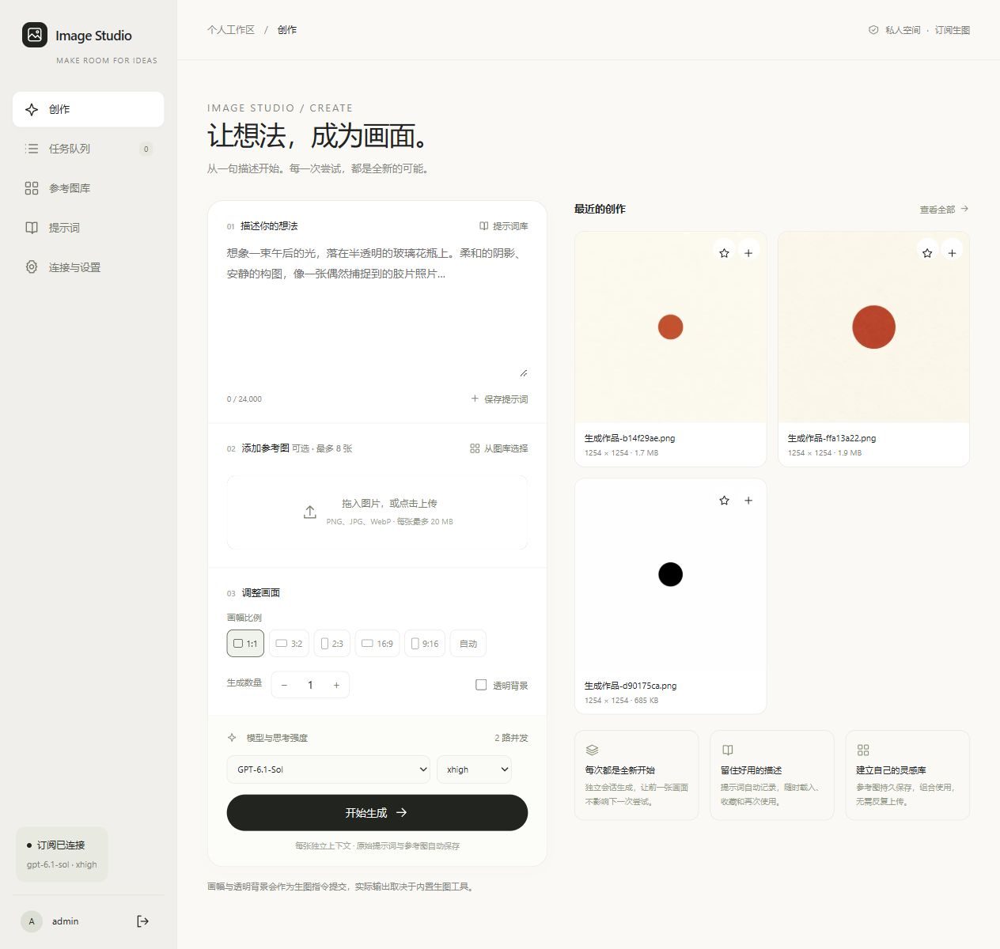
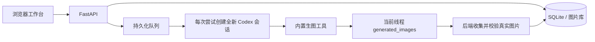

# Image Studio · Codex 生图工作台

将官方 Codex CLI 的订阅生图能力整理成可自托管的图片工作台。输入提示词、选择参考图，在独立上下文中并发生成，再按模板归组挑选结果。

前端采用原生 HTML / CSS / JavaScript，后端采用 FastAPI、SQLite 和官方 Codex CLI。生产环境无需前端构建服务，也不依赖桌面聊天窗口。



## 功能

| 模块 | 能力 |
| --- | --- |
| 创作 | 每批 1–20 个任务、最多 8 张参考图、画幅、图像尺寸、透明背景、帮我润色 |
| 产物列表 | 按模板身份归类、未绑定模板统一进入无模板列表、卡片集封面和列表重命名 |
| 参考图库 | 上传去重、搜索、标签、收藏，将生成图片用作参考 |
| 模板 | 保存可复用的部分正文、参考图和生成设置；编辑弹窗支持裁剪内容 |
| 队列 | 1–4 个共享 CLI 会话，普通生成与超分子块共用；支持重试、暂停、整单取消和日志 |
| 模型 | 默认 `gpt-6.1-sol / xhigh`，可选模型与思考强度取自 CLI 目录 |
| 调用设置 | 编辑外层调用、润色与超分分块提示词、插入变量、按任务保存配置快照 |
| 账户设置 | 用户名、密码、退出其他设备、ChatGPT 订阅连接管理 |
| 首次引导 | CLI 检查、浏览器链接或设备码登录、真实生图检查 |
| 独立应用 | Android 安装包、可安装 Web App、竖屏导航、固定生成按钮与参数抽屉 |
| 最近删除 | 图片与图集可恢复删除，保留历史与模板引用 |
| 渐进超分 | 专用工作区、4× / 16× / 64× 面积倍率、每级整图重切、切法预览、预算与实际尺寸 |
| 超分失败处理 | 独立诊断弹窗、缺边与接缝预览、选块重绘、图块完整输入与原始输出同框切换 |
| 存储管理 | 总存储上限、回收站清空、逐任务缓存清理；大图分层预览 |
| 局部重绘 | 全屏预览、缩放拖动、矩形框选、上下文参考重绘，只合成选区内像素 |
| 图片缓存 | Android 与网页共用持久缓存，合并重复下载、限制容量、退出登录清除 |

账户设置与调用设置位于左下角头像菜单。常用页面保留操作和内容，连接、队列及必要说明统一放在状态栏。

手机竖屏采用独立的创作、作品和队列页面，参数从底部摘要打开；账户入口位于顶部头像。Android 10 及以上可安装独立 APK，iPhone 可从 Safari 添加到主屏幕。构建、安装和交互说明见 [独立移动应用](docs/MOBILE.md)。

作品卡片与图片详情可「发送到超分」。4× / 16× / 64× 是面积倍率，对应宽高各 2 / 4 / 8 倍，与图块数量无关。每级宽高各放大 2 倍，融合并验收完整结果后再重新切块；工作区展示每级切法、预期与实际尺寸、生图与验收预算及累计调用次数。支持检查点复用、取消与恢复；完整算法、返回尺寸处理及资源边界见 [渐进超分工作流](docs/STITCHING.md)。

失败或取消后，点击「失败处理 · 选块重绘」打开独立诊断窗口，竖屏下全屏展示。可查看原图、直接拼接与仿射诊断，定位缺失区域和低可信块；点击图块列表右侧「对比」，在同一画框中用一个按钮切换完整输入（含重叠）与模型原始输出，同时查看要求和实际尺寸。返回诊断会保留选块、未提交的约束和滚动位置。

选块重绘保留未选中的返回，当前级变化后重新执行后续级。每个超分任务可填写「统一细节与画风约束」，贯穿各级图块和验收；头像菜单 → 调用设置可编辑「超分 · 分块重绘提示词」，失败处理时可选择使用最新设置。

单张图片不设字节、像素或边长上限，预览使用有界缩略图与按需加载的原生像素图块。账户设置中的「存储与清理」可设置服务器总存储上限（0 表示不限）、清空回收站或清理已停止的超分任务缓存；清理任务缓存保留原图、最终作品、任务和日志。

点击详情图片进入放大预览，支持双指缩放、拖动、适应画面和原生像素查看。预览底部可进入「矩形局部重绘」，框选后填写修改要求并加入共享队列。选区外保留原图，结果保存为新作品。任务详情显示实际尺寸，超分同时显示原图、目标和回传结果尺寸；处理方式与边界见 [局部重绘](docs/LOCAL_EDIT.md)。

“帮我润色”详情、任务详情与作品详情显示新任务保存的润色后提示词；历史记录缺失时显示未记录，不补写旧记录。

加载模板后，创作区显示“模板名称 ×”标签。在模板基础上补写、修改正文或调整参考图，仍归入该模板。点击叉号解除本次关联，提交后进入无模板列表。保存模板会先打开编辑框，可删改正文、移除参考图；不会裁剪当前创作区里的完整请求。

## 工作原理



工作台自动管理 Codex 运行时和会话，没有将订阅能力转换成独立官方 Images API，也不会自动切换到按量付费 API。

图片由后端按当前 `thread_id` 收集，无需模型在沙箱中再执行 shell 复制。并发任务各用各的目录，缺少真实文件时明确报错，不使用占位图伪装成功。

详情见 [工作流说明](docs/WORKFLOW.md)。

## 部署

已验证环境：Ubuntu、Python 3.12、Node.js 24、Codex CLI `0.164.0`，使用 systemd 和 nginx。

```bash
git clone https://github.com/GYPp1us/codex-image-studio.git
cd codex-image-studio
sudo mkdir -p /opt/image-studio/current
git archive HEAD | sudo tar -x -C /opt/image-studio/current
bash /opt/image-studio/current/deploy/install.sh
```

安装脚本建立独立 Python 环境、安装固定版本的 Codex CLI，并启动 `127.0.0.1:8788` 后端。域名、HTTPS、nginx 和升级操作见 [部署与维护](docs/DEPLOYMENT.md)。

首次打开页面时，从部署机器读取初始化密钥：

```bash
sudo cat /var/lib/image-studio/setup-token
```

创建自己的管理员账户，再通过引导连接 ChatGPT。仓库没有通用初始密码，不包含已部署实例的账户、图片库、会话或订阅凭据。

## 登录

默认使用官方浏览器链接登录。远程服务器可用两种方式接收 OAuth 回调：

1. **手动提交**：授权后如果跳转到 `localhost:1455` 却无法访问，复制地址栏的完整回调 URL，在工作台的受保护表单内提交。
2. **SSH 转发**：在打开浏览器的电脑上运行下面的命令，再打开引导生成的官方登录链接。完成后关闭转发。

```bash
ssh -N -L 1455:127.0.0.1:1455 user@your-server
```

后端验证当前 OAuth `state`，只转交给 `127.0.0.1:1455` 上的官方 CLI，令牌交换由 Codex 完成。允许设备码登录的账户也可使用设备码。

官方说明：[Codex Authentication](https://learn.chatgpt.com/docs/auth)。

## 开发与测试

以下命令适用于 Linux。集成测试使用假 CLI，不需要 OpenAI 凭据，不消耗订阅额度。

```bash
python3 -m venv .venv
. .venv/bin/activate
pip install -r requirements.lock.txt
python -m unittest discover -s tests -v
node --check static/app.js
npm ci --ignore-scripts
npm test
```

本地启动：

```bash
export STUDIO_DATA="$PWD/data"
export STUDIO_SETUP_TOKEN="$(python -c 'import secrets; print(secrets.token_urlsafe(24))')"
export CODEX_BIN="$(command -v codex)"
uvicorn app:app --host 127.0.0.1 --port 8788
```

测试覆盖账户与 CSRF、图片校验去重、并发取消与重试、模型和调用模板快照、模板与列表归组、数据库迁移，以及渐进切图、异常尺寸返回、缓存清理、大图预览、润色提示词记录、选块重绘和输入输出对比。超分测试使用合成图与模拟 CLI；自动测试不能替代真实模型的画质验收。已部署实例还完成过两路携带参考图的真实并发生成。

## 数据与边界

- 选择的是外层执行模型，图片由内置生图工具生成；模型目录不等于账户权限保证。
- 画幅、图像尺寸和透明背景通过指令提交，不保证工具严格输出指定规格；普通生成按实际像素保存，详情展示真实尺寸。超分独立校验返回尺寸、配准与融合，画幅异常会重试，原生尺寸不足会局部细分；无法通过检查时保留失败状态。
- 超分重切可让旧接缝进入新图块内部，仍可能出现结构变化或无法配准。预算随异常返回、细分和重绘更新；大图受可用磁盘、总存储限额与规划规模约束，存储上限是写入前检查，不是文件系统硬配额。
- 缓存表示工作台保存与复用，不代表 OpenAI 计费缓存；每次抽卡仍重新生成。
- 图片在本机浏览器或 Android WebView 的 Cache Storage 中持久保存，最多 192 MB、300 个文件；账户设置可清理，退出登录自动清理。浏览器存储压力、系统清理或超出容量时仍会重新下载。
- 速度、额度、限流和能力受当前工具、账户及服务状态影响。
- 数据库、参考图和凭据保存在服务器；不要提交 `codex/auth.json` 等运行文件。
- 只运行一个 uvicorn worker，由应用内部控制生图并发，不能靠增加 Web worker 扩展调度。
- 本项目为独立工具，与 OpenAI 无隶属关系。

## 目录

```text
app.py                        后端、迁移、队列、CLI 调用与图片收集
stitch_planner.py             渐进级别、重叠切图、预算与局部细分
upscale_workflow.py           逐级超分、检查点复用与选块重绘
upscale_api.py                超分任务、诊断与对比、存储清理接口
upscale_diagnostics.py        失败拼图与图块输入输出预览
stitch_engine.py              仿射配准、图割接缝与分块融合
image_runtime.py              流式图片处理、有界预览与原生图块
storage_manager.py            存储统计、配额检查与安全路径
prompt_capture.py             保存新任务的润色提示词
local_edit.py                 矩形上下文裁切、选区示意与有边界的合成
static/                       前端页面、样式与交互
tests/                        后端集成、图像算法与前端交互测试
deploy/install.sh             安装与 systemd 部署
deploy/image-studio.service   服务定义
deploy/nginx*.example         nginx 与 HTTPS 配置示例
deploy/studio_operator.py     从标准输入读取凭据的运维工具
docs/WORKFLOW.md              生图、预设、分组和重试工作流
docs/STITCHING.md             渐进超分、失败恢复、图块对比与存储边界
docs/DEPLOYMENT.md            部署、备份、升级与排障
requirements.lock.txt         已验证环境的依赖版本
```
