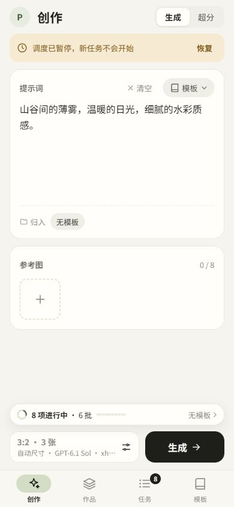
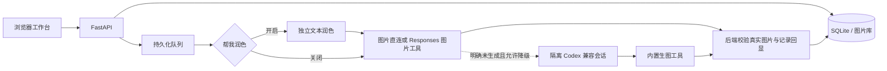

# Image Studio · Codex 生图工作台

将 ChatGPT / Codex 的订阅生图能力整理成可自托管的图片工作台。输入提示词、选择参考图，通过图片直连或 Responses 托管工具并发生成，也可降级为 Codex CLI，再按模板归组挑选结果。

前端采用原生 HTML / CSS / JavaScript，后端采用 FastAPI、SQLite 和官方 Codex CLI。生产环境无需前端构建服务，也不依赖桌面聊天窗口。



新图片链路、独立润色、真实显影、兼容降级和请求回显见 [图片数据流](docs/DIRECT_BACKEND.md)。服务端未回显的模型与质量不会用请求值填充。

## 功能

| 模块 | 能力 |
| --- | --- |
| 创作 | 每批 1–20 个任务、最多 8 张参考图、画幅、图像尺寸、透明背景、帮我润色 |
| 产物列表 | 按模板身份归类、未绑定模板统一进入无模板列表、拼贴封面和列表重命名 |
| 参考图库 | 上传去重、参考图 / 作品分页选择；图片信息可编辑名称与标签，菜单可收藏 |
| 模板 | 保存正文、参考图和生成设置；编辑增减和排序参考图，载入保留现有草稿 |
| 任务 | 批次与生成→超分父子层级、真实区域/分块进度、1–4 个共享调用并发槽；日志并入详情 |
| 模型 | 图片模型/质量独立请求；文本模型默认 `gpt-6.1-sol / xhigh`，用于独立润色、验收与 CLI |
| 图片数据流 | 图片直连、Responses 流式或 CLI 兼容；独立润色后生图、真实显影、请求/回显/实际图片属性对照 |
| 调用设置 | 图像正文、独立文本润色与七类超分模板；高级拼接开关、不可变任务快照与实际调用记录 |
| 账户设置 | 自定义头像与裁剪、用户名、密码、退出其他设备、ChatGPT 订阅连接管理 |
| 外观 | 跟随系统 / 浅色 / 暗色、六组预设与自定义主题色、自动调整文字对比度 |
| 参考图选择 | 固定加入按钮、每页 40 张、主体预览与角标勾选；直接长按图片横向排序，创作与模板共用 |
| 订阅连接 | CLI 状态、浏览器链接或设备码登录、手动真实生图检查 |
| 独立应用 | Android / Web App、横竖屏工作区、查看器隐藏系统栏、菜单遮罩同步系统栏配色 |
| 最近删除 | 图片与图集可恢复删除，保留历史与模板引用 |
| 渐进超分 | 专用工作区、4× / 16× / 64× 面积倍率、每级整图重切、切法预览、预算与实际尺寸 |
| 超分失败处理 | 独立诊断弹窗、缺边与接缝预览、选块重绘、图块完整输入与原始输出同框切换 |
| 存储管理 | 服务器容量、工作台已用与可用额度；存储上限、回收站、逐任务缓存清理与分层预览 |
| 图片查看器 | 点图片直接打开、双指缩放、滑动切图、操作底栏、ⓘ 来源与提示词面板 |
| 速改 | 一句话修改，可保持原图规格、使用原图参考或按创作参数重生成，保留来源记录 |
| 局部重绘 | 最多 6 个不重叠矩形、独立或共用要求、共享并发处理，完成后合成一张新图 |
| 图片缓存 | Android 与网页共用持久缓存，合并重复下载、限制容量、退出登录清除 |

头像菜单的「设置」整合账户、订阅、默认值、速改、超分、队列、调用提示词、显示与存储，修改自动保存。连接与调度正常时不显示系统状态栏，异常时显示提示横幅。

界面沿用 [PR #1 demo](docs/ui-proposal/index.html) 的组件、图标与动效语言。竖屏使用四项底部导航；横屏改为导航轨道、创作与参数双栏、任务与详情主从布局、图片画布与操作侧栏。参考图直接长按排序，作品长按进入批量选择。生成后保留草稿并原地反馈，等待网络或保存的操作显示忙碌状态并防止重复提交。Android 10 及以上可安装独立 APK，iPhone 可从 Safari 添加到主屏幕。构建与安装见 [独立移动应用](docs/MOBILE.md)，本轮模块与验收清单见 [大修计划](docs/OVERHAUL_PLAN.md)。

作品页提供「作品 / 参考图 / 收藏」分栏。参考图与收藏直接从服务器分页读取，收藏同时包含作品与参考图；查看器按当前分栏的图片顺序切换。左右拖动按帧更新，复用已经显示的相邻图片，并支持快速轻扫切换。

参考图选择页的加入按钮固定在底部，滚动到底部会继续加载，网络失败时可重试。点击图片主体放大，预览中仅保留选择本图；选择和返回不改变滚动位置。已加入的参考图可点击预览，长按图片后横向拖动调整发送给模型的顺序。模板编辑共用同一套选择、预览和排序，并保留未保存的名称和正文；纯参考图模板不显示空提示词框。载入模板时已有提示词原样保留，空白时才填入模板正文；参考图按已有顺序去重补充，超过 8 张时保留已有图并提示。

生图页提供「快速设置」栏。长按详细参数中的选项可固定不同取值，短按快捷项应用到本次创作，长按后横向拖动排序，原地松开编辑名称或移除，移除后可撤销。支持固定多个常用图片模型；新增 `gpt-image-2.6-sunburst` 与 `gpt-image-2.6-flare`，本次不包含 GIF。快捷项保存在账户设置，实际生成参数在提交任务时冻结；保存中显示反馈，失败恢复原设置并保留编辑内容。

快捷项只覆盖本次明确选择的字段，其余图片通道参数使用提交时的服务器设置；「再抽一张」保留原任务冻结的图片配置。旧配准与局部修复结果的保留、实际覆盖缺口重试和预算修正见 [PR #11 审阅修正](docs/PR11_REVIEW.md)。

设置的「外观」支持实时切换颜色模式和主题色，刷新后恢复；跟随系统会响应系统外观变化。头像支持拖动定位、缩放裁剪和恢复默认，保存为 512×512 WebP，单独存储并计入存储限额，不加入参考图库。上述功能由网页更新提供，Android APK 1.1.0 可直接使用。

动效设置统一控制 CSS 和手势动画：「完整动效」优先于系统减少动态效果，「跟随系统」实时响应系统偏好；「减少动效」停止循环指示器，避免把转圈和流光加速到 1 毫秒。底部导航在页面切换中使用独立的静态快照层。触屏浏览器支持 Fullscreen API 时，点击图片会尝试全屏查看；关闭动画和退出全屏完成后再恢复顶部配色。iPhone Safari 尚不支持普通页面的该全屏能力，保留系统栏并使用深色查看器配色。

查看器操作栏可「发送到超分」。4× / 16× / 64× 是面积倍率，对应宽高各 2 / 4 / 8 倍，与图块数量无关。每级宽高各放大 2 倍，融合并验收后重新切块。超分检查工作区统一显示切法、预期与实际尺寸、预算、调用次数及失败处理；列表收起显示短进度条，展开显示可横滚的复合阶段图，已完成任务不再显示执行条。支持检查点复用、取消与恢复；算法见 [渐进超分工作流](docs/STITCHING.md)。

纯色及严格判定的平滑渐变背景使用不锐化的双线性插值，不消耗模型调用；含轮廓、文字或细节的图块继续补绘。纹理不足不再作为补绘前的阻断条件，无法可靠估计仿射时会校验已知画幅与局部可见内容；实际融合仍要求完整覆盖。预算扣除本地处理图块，进度单独标记「插值」，显式选块修复仍执行模型调用。

失败或取消后，点击「失败处理 · 选块重绘」打开独立诊断窗口，竖屏下全屏展示。可查看原图、直接拼接与仿射诊断，定位缺失区域和低可信块；点击图块列表右侧「对比」，在同一画框中切换完整输入（含重叠）与模型原始输出，同时查看要求和实际尺寸。返回诊断会保留选块、未提交的约束和滚动位置。

任务统一要求贯穿各级；原图历史描述须明确选择后才附带。七类超分模板在设置中分别编辑，提交时冻结版本，预览与执行使用同一编译器。选块修复只作用于本级所选图块，保留其他检查点，并重新执行后续级；采用最新修复模板也不会改写全局要求。需要新全局要求或系统版本时，可复制为新任务。详情展示实际发送记录，旧任务缺失记录时明确降级。详见 [超分提示词架构](docs/UPSCALE_PROMPTS.md)。

单张图片不设字节、像素或边长上限，预览使用有界缩略图与按需加载的原生像素图块。拖动和缩放共用一个合成层，每帧合并输入，移动中持续补充高清图块；最多 4 路加载，解码图块缓存预算 64 MiB，回拖复用缓存。设置中的「服务器存储」可设置服务器总存储上限（0 表示不限）、清空回收站或清理已停止的超分任务缓存；清理任务缓存保留原图、最终作品、任务和日志。

点击图片直接进入查看器，支持双指缩放、拖动、滑动切图、适应画面和原生像素查看。底栏集中下载、用作参考、再抽、局部重绘和超分；速改输入框可直接提交一句修改要求。局部重绘可选择最多 6 个不重叠区域，各区域并行处理后合成一张新作品，选区外保留原图。处理方式与边界见 [局部重绘](docs/LOCAL_EDIT.md)。

网页 / PWA 下载原图时展示真实字节数与进度，复用查看原图所用的本机缓存。支持文件分享的手机会提供「保存到相册 / 分享」，由系统菜单选择保存；也可直接下载原图。高清图块和有界预览不等同于完整原图，尚未缓存完整文件时仍需首次下载。取消或关闭面板会停止读取，保存过程不重新编码图片。

Android 1.2 的保存直接从同一缓存 Blob 分段写入 `Downloads/ImageStudio`，不交给系统下载管理器，也不另外携带登录 Cookie 发起下载请求。面板分别显示原图读取和文件写入进度，文件名后缀与真实内容匹配。应用按设备实际空闲空间检查能否保存。

“帮我润色”详情、任务详情与作品详情显示新任务保存的润色后提示词；历史记录缺失时省略该部分，不补写旧记录。

加载模板后，创作区的“归入”行显示模板名称。在模板基础上修改正文或参考图，仍归入该模板；差异较大时会提醒，可解除关联后归入无模板列表。保存模板会先打开编辑面板，可删改正文、移除参考图；不会裁剪当前创作区里的完整请求。清空草稿可在 5 秒内撤销，保留生成参数。

## 工作原理



图片直连和 Responses 都使用项目现有 ChatGPT 订阅后端，CLI 保留为兼容路径。公共 API 文档仅作协议参考，不代表订阅端的参数保证，也不会自动启用单独计费的 API Key 路径。

直连图片按原始返回字节校验和存储；CLI 图片按当前线程收集。并发调用各用独立目录，缺少有效图片会明确失败。中间显影预览单独生成，并标明是否为最终作品。

详情见 [工作流说明](docs/WORKFLOW.md)。

## 部署

已验证环境：Ubuntu、Python 3.12、Node.js 24、Codex CLI `0.164.0`，使用 systemd 和 nginx。

```bash
git clone https://github.com/GYPp1us/codex-image-studio.git
cd codex-image-studio
sudo mkdir -p /opt/image-studio/current
git archive HEAD | sudo tar -x -C /opt/image-studio/current
bash /opt/image-studio/current/deploy/install.sh
```

安装脚本建立独立 Python 环境、安装固定版本的 Codex CLI，并启动 `127.0.0.1:8788` 后端。域名、HTTPS、nginx 和升级操作见 [部署与维护](docs/DEPLOYMENT.md)。

首次打开页面时，从部署机器读取初始化密钥：

```bash
sudo cat /var/lib/image-studio/setup-token
```

创建自己的管理员账户，再通过引导连接 ChatGPT。仓库没有通用初始密码，不包含已部署实例的账户、图片库、会话或订阅凭据。

## 登录

默认使用官方浏览器链接登录。远程服务器可用两种方式接收 OAuth 回调：

1. **手动提交**：授权后如果跳转到 `localhost:1455` 却无法访问，复制地址栏的完整回调 URL，在工作台的受保护表单内提交。
2. **SSH 转发**：在打开浏览器的电脑上运行下面的命令，再打开引导生成的官方登录链接。完成后关闭转发。

```bash
ssh -N -L 1455:127.0.0.1:1455 user@your-server
```

后端验证当前 OAuth `state`，只转交给 `127.0.0.1:1455` 上的官方 CLI，令牌交换由 Codex 完成。允许设备码登录的账户也可使用设备码。

官方说明：[Codex Authentication](https://learn.chatgpt.com/docs/auth)。

## 开发与测试

以下命令适用于 Linux。集成测试使用假 CLI，不需要 OpenAI 凭据，不消耗订阅额度。

```bash
python3 -m venv .venv
. .venv/bin/activate
pip install -r requirements.lock.txt
python -m unittest discover -s tests -v
node --check static/app.js
npm ci --ignore-scripts
npm test
```

本地启动：

```bash
export STUDIO_DATA="$PWD/data"
export STUDIO_SETUP_TOKEN="$(python -c 'import secrets; print(secrets.token_urlsafe(24))')"
export CODEX_BIN="$(command -v codex)"
uvicorn app:app --host 127.0.0.1 --port 8788
```

测试覆盖账户与 CSRF、图片校验去重、并发取消与重试、模型和调用模板快照、模板与列表归组、数据库迁移，以及渐进切图、异常尺寸返回、缓存清理、大图预览、润色提示词记录、选块重绘和输入输出对比。超分测试使用合成图与模拟 CLI；自动测试不能替代真实模型的画质验收。已部署实例还完成过两路携带参考图的真实并发生成。

## 数据与边界

- 图片模型/质量与润色、派发、验收文本模型分别设置；CLI 模型目录只用于文本模型选择，不保证图片模型权限或服务端实际路由。
- 直连将尺寸、质量和透明背景作为接口参数提交，订阅端仍可能返回不同规格；CLI 兼容路径也不保证指定规格。详情区分请求值、服务端回显及实际图片属性，缺失字段显示未知。超分独立校验尺寸、配准与融合，画幅异常会重试，原生尺寸不足会局部细分；无法通过检查时保留失败状态。
- 超分重切可让旧接缝进入新图块内部，仍可能出现结构变化或无法配准。预算随异常返回、细分和重绘更新；大图受可用磁盘、总存储限额与规划规模约束，存储上限是写入前检查，不是文件系统硬配额。
- 缓存表示工作台保存与复用，不代表 OpenAI 计费缓存；每次抽卡仍重新生成。
- 图片在本机浏览器或 Android WebView 的 Cache Storage 中持久保存，最多 192 MB、300 个文件；账户设置可清理，退出登录自动清理。浏览器存储压力、系统清理或超出容量时仍会重新下载。
- 速度、额度、限流和能力受当前工具、账户及服务状态影响。
- 数据库、参考图和凭据保存在服务器；不要提交 `codex/auth.json` 等运行文件。
- 只运行一个 uvicorn worker，由应用内部控制生图并发，不能靠增加 Web worker 扩展调度。
- 本项目为独立工具，与 OpenAI 无隶属关系。

## 目录

```text
app.py                        后端、迁移、队列、CLI 调用与图片收集
stitch_planner.py             渐进级别、重叠切图、预算与局部细分
upscale_workflow.py           逐级超分、检查点复用与选块重绘
upscale_api.py                超分任务、诊断与对比、存储清理接口
upscale_prompts.py            有作用域的超分指令编译、配置快照与版本
task_progress.py              任务进度只读投影与重试检查点保留
upscale_diagnostics.py        失败拼图与图块输入输出预览
stitch_engine.py              仿射配准、图割接缝与分块融合
image_runtime.py              流式图片处理、有界预览与原生图块
storage_manager.py            存储统计、配额检查与安全路径
prompt_capture.py             保存新任务的润色提示词
interaction_api.py            工作区偏好、速改、图片来源与批次接口
region_workflow.py            多区域并发重绘、检查点与合成
local_edit.py                 矩形上下文裁切、选区示意与有边界的合成
static/                       前端页面、样式与交互
tests/                        后端集成、图像算法与前端交互测试
deploy/install.sh             安装与 systemd 部署
deploy/image-studio.service   服务定义
deploy/nginx*.example         nginx 与 HTTPS 配置示例
deploy/studio_operator.py     从标准输入读取凭据的运维工具
docs/WORKFLOW.md              生图、预设、分组和重试工作流
docs/UI_IMPLEMENTATION.md     四标签导航、查看器、面板和编辑重构
docs/STITCHING.md             渐进超分、失败恢复、图块对比与存储边界
docs/DEPLOYMENT.md            部署、备份、升级与排障
requirements.lock.txt         已验证环境的依赖版本
```
