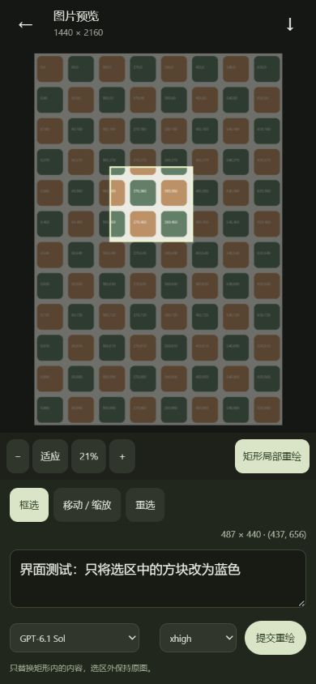

# 矩形局部重绘

图片详情与任务详情中的图片均可打开全屏预览。点击「矩形局部重绘」，拖动框选原图中的区域，输入修改要求后提交。坐标按原生图片像素保存，缩放或拖动画面不改变坐标含义；选区宽高至少 16 像素，必须完整位于图内。修改结果保存为新作品，原图保留。

## 调用与合成

订阅生图工具没有结构化遮罩参数，本功能使用普通透传任务：参考图 1 是包含选区与周边上下文的裁图，参考图 2 是完整原图，参考图 3 是黑白选区示意图。任务要求只修改白色区域、保持黑色区域，输出编辑后的裁图。它沿用普通调用提示词的快照，不切换到「帮我润色」，不向模型讲解后端处理流程。

回传图使用 Lanczos 和居中裁切适配上下文裁图的尺寸，然后只提取原始矩形内的结果。选区边缘最多 8 像素向内羽化，过渡计算始终位于矩形内；选区外像素逐点保留原图，整图宽高与透明通道也保留。模型仍可能改变选区内的布局，示意图不能代替模型的精确几何保证；本功能不提供原生遮罩 API 或可调重绘强度。

## 队列与记录

局部重绘与普通生图、超分子块共享全局 CLI 并发上限，支持取消、失败重试和诊断日志。记录保留原图 ID、矩形像素坐标、修改要求、模型、思考强度和调用提示词。任务详情显示原图与结果尺寸，可以从原图继续框选；「载入创作设置」恢复选区和修改要求，「再抽一张」按相同原图与选区创建新任务。

接口为受工作台登录和 CSRF 保护的 `POST /api/assets/{id}/inpaint`，正文包含 `prompt`、`region: {x,y,width,height}`，以及可选的 `model`、`effort`。不调用按量付费 Images API。自动测试使用 CLI 替身验证合成及队列行为，不消耗真实生图额度。
