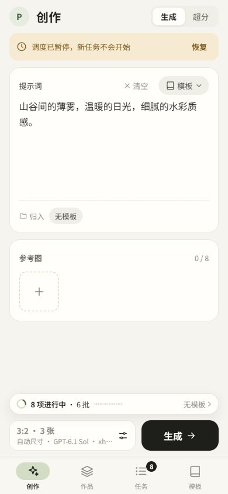
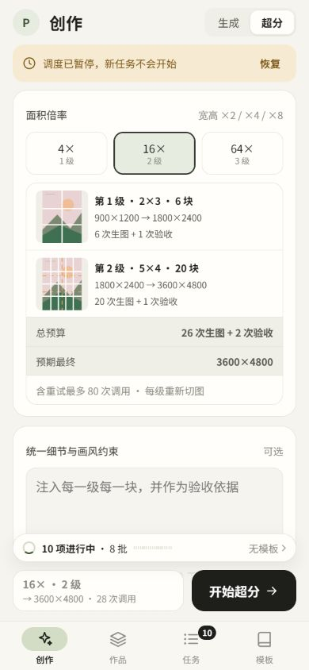
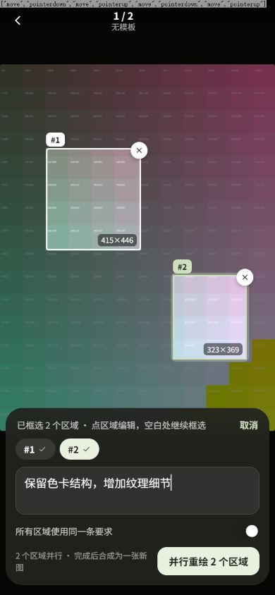
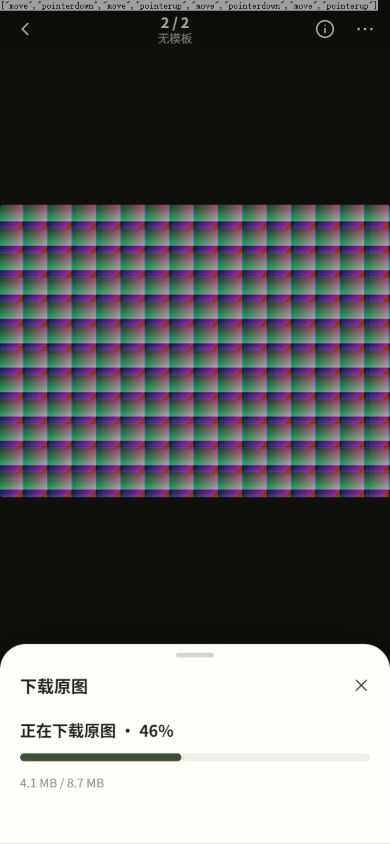
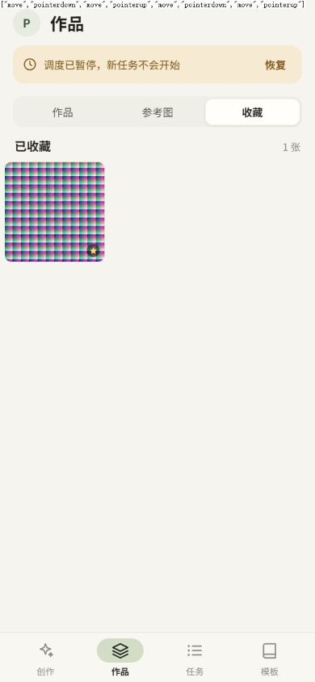
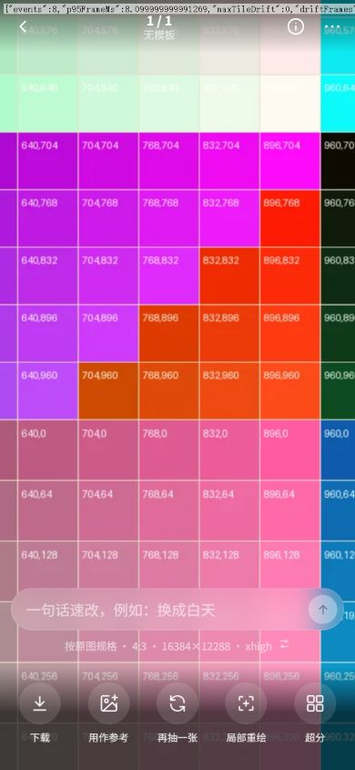
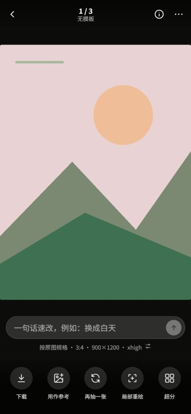

# PR #1 demo 实装

界面基准为 [交互原型](ui-proposal/index.html)，对应 PR #1 的 `4a307bc`。生产入口直接移植原型的组件 HTML、SVG 路径、CSS 与交互代码；模拟图片、模拟调度器及演示按钮已移除。桌面采用 390 像素单列，宽度不超过 900 像素时按原型铺满视口。

## 界面与交互

- 创作保留原型的提示词卡片、归入行、68 像素参考图、底部参数摘要及生成反馈。参数在底部面板中编辑，提交后保留草稿。
- 作品采用最近生成横列、两列拼贴封面及列表内三列图片网格。任务采用批次卡片与展开区域，参考图与上传位于图片选择面板。
- 作品页增加「作品 / 参考图 / 收藏」分栏，沿用原型分段控件和三列网格；参考图与收藏独立分页，保留各自滚动位置，查看器按当前分栏导航。收藏通过服务器查询读取，不依赖最近任务是否已加载。
- 点图打开查看器；下方提供速改输入与五项图片操作。长按菜单、信息面板、区域重绘、单面板内容切换、拖动关闭及逐层返回沿用原型。
- 设置采用原型的分组行、开关、分段选项与步进器。账户、授权、回收站和服务器清理等原型留空的操作也使用相同组件。
- 每一级超分计划取自服务器，增加同款行内切法缩略图；任务的“尺寸与预算”面板同时显示实际结果与调用记录。失败处理保留三视图、叠加选块、输入输出切换及固定提交栏。

390×844 实测中，标题栏、标题、头像、卡片、卡片头、提示词框、参考图添加按钮、参数摘要、生成按钮、导航栏、导航图标区域的尺寸、字号、圆角、内边距和间距与原型相同。另检查 360×780、780×360 和 1280×900；关闭、步进器等 SVG 的中心与按钮中心重合。



## 真实数据接入

原型中的固定预算、示例错误和图片变形滤镜不进入实际计算。所有任务状态、图块编号、诊断图片、输入输出尺寸与预算均来自 API。旧界面的本地草稿会迁移到新创作页，正文、参考图、模板及参数保留；较早的参考图按 ID 读取。

生成后超分的父子任务共用真实 `batch_id`，在同一卡片中完整展示；子任务有独立的进度和失败处理入口。分页先读取完整批次，不会把 20 张任务截成两张卡片。历史列表与图片可分页读取，封面计数采用服务器总数。

查看器保留原始像素查看、平移、双指缩放和按需 DZI 图块，入口位于更多菜单（带缓动动画）；双击以手指为中心缓动放大到 2–3 倍，再次双击回到适应画面。常规显示先用网格缩略图占位，有界预览解码完成后替换，当前图优先加载、相邻图低优先级预取。进入区域重绘时回到适应画面，最多六个不重叠区域在提交前换算为原图像素；键盘或视口变化会重新投影选区。

高清预览加载或解码失败时保留已有缩略图；不支持 `Image.decode()` 的浏览器等到 `load` 成功后才替换。旧预览的迟到响应不能覆盖新来源。滚轮或即时原生像素操作会取消尚未结束的缩放和惯性动画，保留最新操作结果。捏合缩小后的回弹在整个动画期间保留缩放层，到达适应画面后才释放；最后一根手指松开不会被误判成单击。减少动态效果模式直接回到适应画面。

底图和高清图块放在同一合成层，通过 `requestAnimationFrame` 每帧只更新一次位移与缩放；指针移动中不读取布局，也不修改图片尺寸。高清图块每 90 ms 按可见范围更新，最多 4 路加载及解码，解码缓存预算 64 MiB / 96 项，视口所需图块最多 56 张。回拖复用已解码图块，切换清晰度时短暂保留对齐的旧层；退出预览、返回适应画面或注销后释放资源。预览开启时暂停隐藏作品页的布局更新。

适应画面下的左右切图同样合并到每帧一次位移，手势开始时缓存坐标比例；切换完成复用原有相邻图片节点，避免重新解码。快速轻扫按位移与速度决定切换，新的拖动会结束旧的切换或回弹，取消手势不会误切图或关闭预览。

重绘曾使用 `closest('.rm')` 排除删除按钮，恰好与减少动态效果模式的 `html.rm` 冲突，导致整页无法框选。现在限定为选区中的删除按钮；手机框选独立处理触摸，取消或多指输入会丢弃未完成选区。框选结束不自动弹键盘，视口变化时取消未完成的框并重新投影已有选区。

网页下载通过与查看原图相同的 URL 和鉴权缓存读取文件，面板展示真实字节、百分比与结果尺寸；服务器未提供长度时显示不定进度。文件分享由用户在原图准备完成后再次点击触发，保留系统要求的用户手势；不支持时使用同一 Blob 下载。关闭面板会取消读取并清理临时 URL，迟到结果不会覆盖新面板或触发保存。Android 原生客户端继续使用系统下载管理器。

速改的“保持原图规格”和“以原图为参考”均对应真实配置。关闭保持规格后，传入当前创作的画幅和尺寸；关闭参考后，不再向工具传入原图。原图来源仍保留。图像详情显示实际宽高比例，生成参数保留请求比例，两者可以不同。

润色后的提示词位于图片信息及任务详情；旧记录缺失时省略，不回填。模型与可选思考强度取自 CLI 目录。设置保存串行执行，提交失败保留输入，任务已被服务器接受后不会因随后轮询失败而显示成提交失败。

失败选块使用稳定图块编号，支持自适应细分后的非连续编号。对比展示完整输入和模型原始输出，按各自比例容纳在同一画框内。费用说明区分本级预算与需要重做的后续级预算。



## 布局与安全策略

服务器继续使用 `style-src 'self'; script-src 'self'`。原型模板中的布局值转为 `data-layout`，由脚本通过 CSSOM 应用，避免 HTML 内联样式被 CSP 拦截。没有放宽 CSP。

底部面板复用同一层，内容替换有版本检查；迟到的图片信息或诊断响应不能覆盖后来打开的面板。history 返回串行执行，浏览器返回、拖动关闭与 Android `studioBack()` 共用层级。

## 模块

| 文件 | 职责 |
| --- | --- |
| `static/studio-ui.js` / `studio.css` | 原型组件、渲染、图标、手势与层级 |
| `static/studio-service.js` / `studio-service.css` | 登录、真实数据、API 操作、偏好、存储及原型留空入口 |
| `static/studio-layout.js` | 保留 CSP 的布局值应用 |
| `static/studio-zoom.js` | 缩放、平移、可见高清图块及选区重投影 |
| `static/studio-download.js` / `image-cache.js` | 原图读取进度、缓存复用与系统保存 / 分享 |
| `interaction_api.py` | 偏好、速改、完整批次及图片来源 |
| `region_workflow.py` | 多区域共享并发与完整结果合成 |
| `call_errors.py` | 区分真实鉴权状态码与图片路径、时间戳中的数字 |

生产入口只加载上述界面模块及图片缓存模块。旧页面脚本和样式不再由入口加载。

## 验证

```bash
npm test
python -X utf8 -m unittest discover -s tests -v
```

完整后端回归 105 项与前端回归 82 项通过。前端测试覆盖组件样式与原型一致、CSP 布局、真实提交参数、完整批次、模板恢复、速改失败保留输入、诊断稳定编号、设置持久化、返回层级、原生图块、迟到响应及提交后的网络错误。新增回归检查减少动效下的鼠标与触摸框选、连续选区和取消、左右切图合帧与节点复用、旧收藏与参考图分页、真实下载字节、系统分享手势、取消读取及迟到结果。大图性能回归继续覆盖布局读取、图块并发、缓存上限与复用、双指锚点、原生边缘图块和关闭后迟到请求。

PR #3 审查后的 11 项新增回归覆盖预览解码等待、失败回退、无 `decode()` 时的加载事件、迟到来源保护、滚轮中断缩放或惯性、回弹中间帧及结束清理、双指松开判定、减少动效、关闭时取消动画和即时查看原生像素。此前三项审查复现脚本也全部通过。

隔离浏览器中验证了减少动效下的双区域框选、左右切图、参考图及收藏分栏。8.7 MB 合成原图在慢速响应下显示实际进度，保存文件 SHA256 与源文件一致；再次准备同一原图、准备已经查看过的 1200×1600 原图时，服务器均未收到新的原图请求。缓存总预算、主动清理或浏览器回收会影响后续命中；真实手机系统保存菜单仍以设备支持为准。







大图性能对照使用 16384×12288 合成样图、390×844 视口和每块 120 ms 的响应延迟，在同一桌面浏览器执行三组相同拖动。优化前，底图移动而高清图块等待手势停止，三组最大错位分别为 210、210、200 像素；优化后均为 0。两版帧间隔 P95 都约 8 ms，改善主要来自消除图层错位与热路径布局工作。独立回归验证 240 次指针更新只产生一次合成层写入、移动中请求新图块、回拖缓存范围不重复下载；真实浏览器另验证滚轮缩放、返回适应画面、局部框选和关闭释放。此对照不等同于真实手机性能测量。



浏览器操作在隔离数据库中实际提交了三张生成、一条速改与两个独立区域重绘；队列保持暂停，未调用真实模型。两个拖动选区提交为原图矩形 `(104,228,231,254)` 和 `(508,367,254,300)`，各自提示词正确保留。也验证了真实失败检查点的诊断和逐块对比。

后端回归额外固定了包含 `401` 的图片路径时间戳，验证损坏返回仍会重试；真实 HTTP 401 / 403 继续被识别。自动测试使用模拟 CLI，不代表真实模型的编辑画质验收。真实手机键盘和系统手势仍需目标设备验证；本轮未启动 Android 或 QEMU 模拟器。


