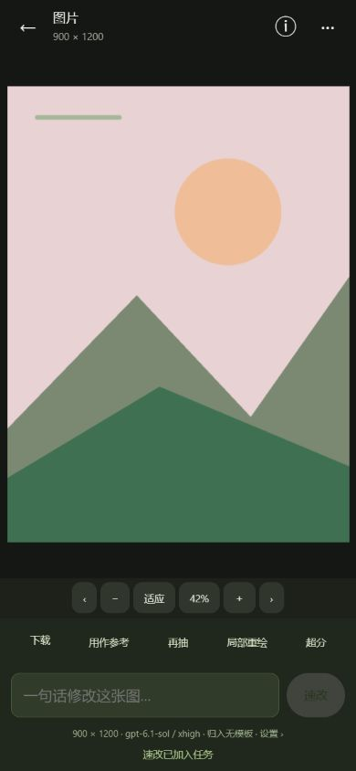

# PR #1 交互重构实现

实现依据：[竖屏交互提案](UI_PROPOSAL.md)。提案和原型保留为设计记录；本页说明产品实现与验证边界。

## 导航与对象

- 主导航为创作、作品、任务、模板四项。参考图库、生成作品和上传均可从参考图选择面板进入。
- 创作页包含生成 / 超分模式，生成提交后保留正文、参考图、模板与参数，原地显示批次状态和结果入口。
- 提交前展示“归入”列表。模板正文差异较大时提醒，可继续提交或解除关联；不会阻止有意修改模板的创作。
- 清空只影响正文、参考图和模板关联，保留参数；5 秒内可以撤销。
- 作品区只显示图片结果，进行中与失败任务汇总为状态条。任务页按 `batch_id` 聚合，同一批次不会被分页截断。
- 点图片直接进入查看器；下载、参考图、再抽、局部重绘、超分及速改集中在这里。名称、标签、原始提示词、润色记录、来源与任务链接位于 ⓘ 面板。

## 返回与动效

`navigation.js` 统一管理列表、查看器、编辑模式、面板、失败处理与输入输出对比的 history 层级。浏览器返回、Android 的 `studioBack()` 和关闭按钮逐层退出。面板内容可以切换，始终只有一个通用面板宿主。

面板支持遮罩、关闭按钮与头部向下拖动关闭。查看器保留双指缩放、原生细节图块、平移；适应大小时可左右滑动切图、向下滑动关闭。图片打开与关闭使用缩略图过渡，列表使用带 key 更新与 FLIP；桌面页面使用可降级的 View Transitions，竖屏页面与共享图片使用不阻挡输入的入场及缩略图过渡。系统减少动态效果或设置关闭动效时跳过动画。

生成参数中的“生成后超分”会先保存原图，再在同一批次内创建独立的超分任务；超分失败不影响已完成原图。父子任务的创建与原图发布处于同一数据库事务，避免重复创建；超分沿用提交时的提示词及模型快照。

## 新编辑接口

`POST /api/assets/{id}/quick-edit` 接受一句 `prompt`，把原图作为参考，请求原图的画幅与实际像素尺寸。模型、思考强度、润色及模板归入策略取自设置快照。实际工具返回尺寸仍会测量并展示，不承诺工具严格遵循像素要求。速改角标来自任务来源记录，重命名不会丢失。

`POST /api/assets/{id}/inpaint` 兼容原单区域格式，也支持 `regions[]`，最多 6 个互不重叠的原生像素矩形；每个区域可提供单独要求，也可使用共用 `prompt`。同一父任务下各区域进入共享 CLI 池并行执行，全部通过后合成为一张新作品。部分失败时不发布残缺结果，已完成区域保留为检查点；取消会释放活动与等待名额。

`GET /api/batches` 先分页批次，再读取整批任务，支持状态筛选。`GET /api/assets/{id}/info` 提供图片和生成来源。新接口均受现有登录、CSRF 与任务校验保护。

## 设置与超分

头像菜单的设置整合账户、订阅、生成默认值、速改、超分、队列、调用提示词、显示和存储。修改自动保存；提示词实时检查 `{prompt}` 并提供变量插入。存储清理继续保留确认步骤。

超分保留完整渐进算法、每级切法、预算、预期与实际尺寸及诊断对比。失败处理新增全选、清除、未选问题块提示、并发说明和本级调用成本。选中的图块仍复用全局并发池。

首次引导的真实检查结果归入系统检查列表，不进入普通作品列表；不回填或重写历史任务。

## 模块划分与验证

| 模块 | 职责 |
| --- | --- |
| `static/navigation.js` | history 层级、通用面板、自定义枚举 |
| `static/workspace.js` | 草稿、图片操作、参考图选择、查看器接入 |
| `static/tasks.js` | 批次任务、分段进度、任务通知 |
| `static/settings.js` | 设置分区、自动保存、提示词检查、减少动效 |
| `static/viewer.js` | 图片几何、手势、原生图块、多区域选择 |
| `interaction_api.py` | 偏好模型、速改、批次与来源接口 |
| `region_workflow.py` | 多区域并发、检查点、取消及最终合成 |

完整后端回归 100 项与前端回归 35 项通过。合成图片、模拟 CLI 和独立数据库用于自动测试；桌面及 390×844、360×780 竖屏用于浏览器走查。未启动 Android / QEMU 模拟器。真实手机键盘、系统返回手势及通知权限仍需目标设备验证；自动测试不代表真实模型的编辑画质验收。
