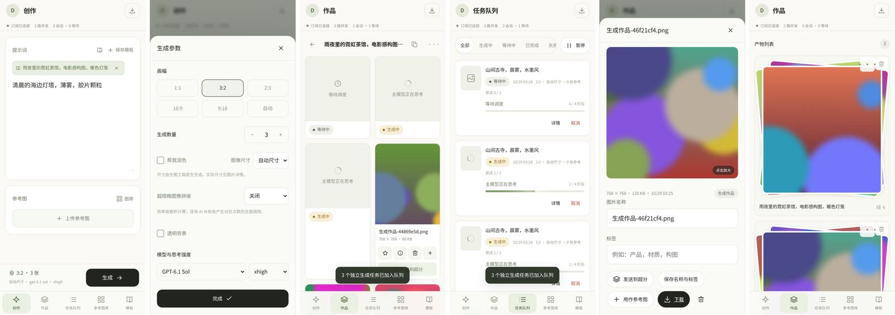
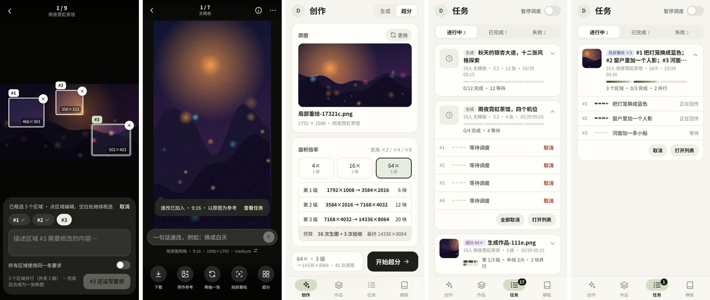

# 竖屏交互范式提案

本文整理了一次竖屏界面走查的结论、讨论后确定的方向和建议的重构路线。**本次只提交文档和可交互原型，不改动产品代码。**

- 可交互原型：[`docs/ui-proposal/index.html`](ui-proposal/index.html)。这是单文件，没有外部依赖，用浏览器直接打开即可。宽屏时左侧是设计说明，右侧是手机原型；窄屏时全屏显示原型。原型使用模拟数据，不连接后端；任务会自动推进，偶尔会失败。
- 走查环境：以 `81f9f16` 本地部署，使用假 Codex CLI，在 390×844 / 360×780 触屏视口用无头 Chromium 逐页操作。下文“现状”指当时的代码，其中超分相关部分已对照 `43bac37` 复核。原型也只在无头 Chromium 中验证过，尚未在真机上检查手势、键盘和返回键。

## 1. 现状问题

| # | 问题 | 表现 |
| --- | --- | --- |
| A | 生成后强制跳页 | 点“生成”后立刻切到“作品”并打开某个列表，草稿和参数都离开了视线 |
| B | 模板归入是隐式的 | “保存模板”会在不提示的情况下把当前创作绑定到该模板；之后即使正文完全不同，产物也会归入该模板的列表 |
| C | 点图片的含义不清 | 点图片先打开名称/标签表单，要再点“点击放大”才进入全屏，局部重绘还在更深一层；生成提示词在图片详情里看不到 |
| D | 作品与队列重复 | “作品”为每个进行中的任务放一张占位卡，“任务队列”又按任务各列一张卡；同一批次的提示词重复出现 |
| E | 入口重复 | 创作页上同时有 4 个模板入口（书本图标、保存模板、模板标签、底栏），参考图有 2 个入口；每张作品卡常驻 5 个操作 |
| F | 系统状态常驻 | 每页顶部常驻“订阅已连接 · 2 路并发 · 0 会话”；键盘弹出时顶栏、状态条、生成栏、底栏共同挤占可用高度 |
| G | 缺少动效 | 底部面板和弹窗没有进出过渡，页面瞬间切换；全部 CSS 中只有 8 处 `transition` |
| H | 返回栈不一致 | Web/PWA 只有查看器使用 `pushState`；APK 的 `studioBack` 一次关闭整个弹窗栈，非创作页按返回会回到创作页而不是上一页 |
| I | 小问题 | 队列筛选在 360 宽时溢出，“暂停”看起来像筛选项；生图检查产生的测试图进入“无模板”；引导页主次按钮倒置；多图任务的阶段条横向并排，4 张以上在窄屏放不下 |

## 2. 范式：每个界面只有一个主对象

对象模型：**批次**（一次提交）→ **任务**（一次 CLI 调用）→ **图片**（产物），图片归属于**列表**（模板身份或无模板）。

| 界面 | 主对象 | 回答的问题 |
| --- | --- | --- |
| 创作 | 草稿 | 下一张要什么？会归入哪里？ |
| 作品 | 图片（按列表分组） | 我得到了什么？ |
| 任务 | 批次 | 系统在做什么？哪里失败了？ |
| 模板 | 模板 | 有什么可以复用？ |
| 查看器 | 单张图片 | 这张图还能做什么？ |

- **解决 D：** “作品”只显示结果。进行中的工作在列表顶部汇总成一条状态条，点击进入任务页；完成的图片以入场动画落入网格。“任务”按 `batch_id` 分组（字段已存在），取消、重试、日志和暂停只放在这里。
- **解决 C：** 点图片直接进入全屏查看器，由缩略图放大过渡。图片相关操作集中在查看器底栏；名称、标签、原始提示词和任务记录移到 ⓘ 信息面板。
- **导航：** 底栏 4 个标签：创作 · 作品 · 任务 · 模板。“参考图库”改为创作页里的选择面板（参考图库 / 作品 / 上传）。头像菜单里只保留：设置、最近删除、安装应用、退出登录。
- **层级：** 标签页 → 列表（推入）→ 查看器（覆盖）→ 面板（覆盖）。同一时间最多一个面板；多步流程在同一面板内切换内容，不叠加第二层。
- **提交不跳页：** 按钮文字变为“已加入 3 张”，一个圆点飞向任务标签，标签徽标跳动，生成栏上方出现批次状态条，点击可到结果所在的列表。

## 3. 操作归属

| 操作 | 主入口 | 快捷入口 | 移除的位置 |
| --- | --- | --- | --- |
| 下载 · 用作参考 · 再抽一张 · 局部重绘 · 超分 | 查看器底栏 | 长按菜单 | 卡片图标行、每张卡上的“发送到超分” |
| 速改（一句话修改） | 查看器输入框 | 长按菜单 | — |
| 收藏 · 删除 | 查看器 ··· / 长按菜单 | — | 卡片常驻图标 |
| 名称 / 标签 | 查看器 ⓘ | — | 图片详情首屏 |
| 用此提示词创作 | 查看器 ⓘ | 任务卡 | — |
| 取消 · 重试 · 日志 | 任务页（展开批次） | 作品状态条跳转 | 作品占位卡 |
| 暂停调度 | 任务页顶部开关 | — | 筛选栏旁 |
| 载入 / 保存模板 | 创作页“模板 ▾”、模板标签页 | — | 单独的书本图标和保存图标 |
| 归入哪个列表 | 提示词下方“归入”行 | 正文与模板差异较大时提示 | 隐式标签 |
| 超分已有图片 | 创作页顶部切换到“超分” | 查看器 / 长按菜单 | 空提示词加“超规格拼接” |
| 连接与并发 | 只在异常时显示横幅；完整状态在设置页 | 任务页 | 常驻状态条 |

## 4. 视觉层级规则

1. 每个界面最多一个深色主按钮。
2. 卡片只展示内容，不放操作按钮；网格里只有图片。
3. 破坏性操作放在菜单末尾、用红色标出，并通过提示条撤销（删除本来就进入“最近删除”），不弹确认框。
4. 用一条状态条或分段进度条汇总状态，不为每个任务放一张占位卡。
5. 系统状态正常时不显示。
6. 提交前就显示结果会归入哪里。
7. 枚举用分段按钮，开关用切换开关，数量用步进器；面板内不使用原生 `<select>`；非表单面板通过拖动、点遮罩或 × 关闭，不再放“完成”按钮。
8. 输入时隐藏底栏，生成栏贴着键盘。

## 5. 动效规范

| 令牌 | 值 | 用途 |
| --- | --- | --- |
| `--d1` / `--d2` / `--d3` / `--d4` | 120 / 200 / 280 / 360 ms | 按压 · 淡入淡出与退出 · 面板与指示器 · 共享元素与入场 |
| `--e-emph` | `cubic-bezier(.32,.72,0,1)` | 进入和移动 |
| `--e-exit` | `cubic-bezier(.4,0,1,1)` | 离开（时长总是更短） |

| 时刻 | 动效 | 实现方式 |
| --- | --- | --- |
| 切换标签 | 淡入并上浮 8px，标签指示器滑动 | View Transitions，`#page` 设置 `view-transition-name` |
| 打开列表 | 封面变形为页头缩略图，内容从右侧推入 | View Transitions，元素命名 `hero` |
| 打开图片 | 缩略图放大为全屏，关闭时（包括滑动切换后）缩回对应缩略图 | 用 `requestAnimationFrame` 驱动的克隆元素 |
| 面板 | 上滑 340ms，可跟手拖动，下滑 220ms 退出 | WAAPI；`<dialog>` 可用 `@starting-style` |
| 结果到达 | 模糊到清晰地缩放入场，相邻项平滑移位 | 带 key 的列表同步加 FLIP |
| 提交 | 按钮文字滚动、圆点飞向任务标签、徽标跳动 | WAAPI |

`prefers-reduced-motion` 以及设置里的“减少动效”会把以上动效都降为瞬时变化。

注意：打开图片的放大动画最初用 WAAPI 实现，在无头 Chromium 中紧跟 View Transition 启动时偶尔停在第一帧，原因未查明。改为 `requestAnimationFrame` 驱动后每次都能完成，移植时建议沿用。

## 6. 返回栈

列表、查看器、重绘模式、面板和全屏页各压入一条 `history` 记录。系统返回、浏览器返回、×、点遮罩和下滑关闭都走 `history.back()`，每次只关闭一层。标签切换不压栈；再次点击当前标签会回到该标签的根页面或滚动到顶部。APK 的 `studioBack()` 改为：层级深度大于 0 时执行 `history.back()`。

## 7. 讨论中追加的功能（原型 v0.2 / v0.3）

- **清空：** 提示词旁的小按钮，只在有内容时出现。清空正文、参考图和模板绑定，保留参数；5 秒内可撤销。
- **速改：** 在查看器输入一句话，按原图的画幅和尺寸、以原图为参考重新生成。说明行显示实际会提交的规格，点击进入设置里的“速改”分区。长按菜单里也有入口。结果带“速改”角标，并在 ⓘ 中链接回原图。
- **设置页：** 合并原来的账户设置和调用设置，分为账户、订阅、生成默认值、速改、超分、任务队列、调用提示词、显示与存储。修改即时保存。其他界面可以直接跳到对应分区并短暂高亮。提示词编辑器会实时检查是否包含 `{prompt}`，并提供变量插入按钮；清理缓存需要再点一次确认。
- **超分入口：** 创作页顶部增加“生成 / 超分”切换。超分模式包含原图选择（最近作品一键选中，或从作品、参考图库、相册选择）、倍率和每级预算，以及画风约束。参数面板里的“超规格拼接”改名为“生成后超分”。
- **超分失败处理：** 与 `upscale-failure.js` 的三栏视图对齐。图块可以多选，提供“问题块 / 全选 / 清除”快捷选择和逐块输入输出对比。提交前显示调用成本；所选块数超过并发数时给出提示和设置入口；有问题块没选中时会警告。所选块通过共享会话池并行重绘。
- **进度显示：** 每个任务一条分段进度条，每段对应一张图、一个图块或一个区域；计数单独占一行，1 到 20 张在 360 宽下都能完整显示。
- **多区域局部重绘：** 最多 6 个互不重叠的矩形区域，每个区域单独填写要求，也可以共用一条。各区域并行处理，完成后合成为一张新图。

## 8. 重构建议（按优先级，本 PR 未实现）

### P0 · 交互语义（问题 C / D）

- `renderShell` / `navigate`：底栏改为 4 个标签；“参考图库”改为选择面板；头像菜单入口改为设置页。
- `assetCard` / `renderRecent`：去掉卡片上的操作行；点图片直接调用 `openImagePreview`；增加长按菜单（桌面端用右键）。
- `assetDetail` 的表单改为查看器里的 ⓘ 信息面板，并显示原始提示词、参数、来源和任务链接。
- `viewer.js`：保留双指缩放和 100% 查看，新增底部操作栏和速改输入框，从缩略图共享元素过渡打开，支持左右滑动切换和下滑关闭。
- `renderQueueItems`：按 `batch_id` 分组，使用分段进度条；作品页的占位卡改为列表顶部状态条。
- `generate()`：提交后不再调用 `navigate`，改为原地反馈。

### P1 · 基础设施

- `modal()`：单一的 `<dialog>` 改为面板宿主，每层对应一条 `history` 记录，多步流程在面板内切换内容。`studioBack` 改为调用 `history.back()`。
- `StudioDOM.updateHTML`：已有带 key 的 morph，再补充移动元素的 FLIP 和新元素的 `enter` 类。
- `navigate` 用 `document.startViewTransition` 包裹，不支持时直接切换。
- 增加动效令牌，统一处理 `prefers-reduced-motion` 和设置中的动效选项。
- 系统状态条改为只在异常时显示的横幅。

### P2 · 新功能与后端改动

- **速改：** 新增 `POST /api/assets/{aid}/quick-edit`（或复用 `POST /api/jobs`）：以原图为参考，画幅和尺寸取自原图，模型、强度和归入位置取自设置中的 `quick.*`。
- **多区域重绘：** `POST /api/assets/{aid}/inpaint` 接受 `regions[]`（每个区域单独的 `prompt`），服务端拒绝重叠区域。每个区域作为子调用进入 `CALL_POOL` 执行 `local_edit.prepare`，全部完成后对同一张底图依次执行 `local_edit.compose`。`compose` 只替换选区内像素，所以不重叠的区域互不影响。任务记录各区域状态和合成阶段。
- **创作 · 超分：** 复用 `GET /api/assets/{aid}/upscale-plan` 和 `POST /api/assets/{aid}/upscale`。“生成后超分”作为生成任务的选项：图片成功后自动创建对应倍率的超分任务。
- **设置：** 新增设置项 `defaults`、`quick`、`upscale.auto_select`、`upscale.default_injection`、`notify`、`motion`；`/api/settings` 和 `/api/call-settings` 合并为同一个页面。
- **超分失败处理：** `upscale-failure.js` 与原型基本一致；需要补充成本说明、并发提示和“未选中问题块”警告（后端已有对应错误信息）。

## 9. 待定事项

- 去掉“参考图库”标签是否可以接受。
- 正文与模板差异较大时，提示是只做提醒还是阻止提交。
- 桌面布局需要另做一轮设计：同一对象模型可以对应 创作 | 作品 | 查看器 三栏。
- 原型只在无头 Chromium 中验证；手势阈值、拖动关闭和键盘行为需要在真机上确认。
