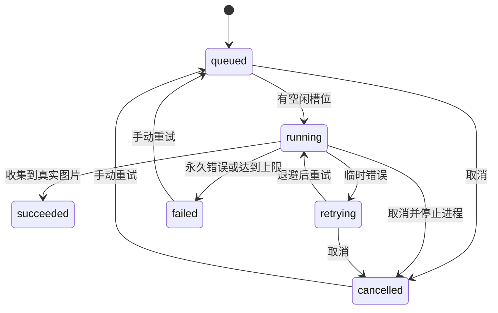

# 工作流说明

## 一次生成

1. 输入提示词，上传参考图或从图库选择，并设置数量、画幅、模型和思考强度。
2. 提交时保存原始提示词、参考图 ID、选项及调用模板快照。
3. 携带模板标签时，按模板 ID 归入对应产物列表，最终正文可以不同。没有模板标签时，每次提交独立建列表，同批次多张图片放在一起。
4. 队列按并发上限执行，每次尝试都启动新的 `codex exec --ephemeral` 会话。
5. 参考图复制到任务独立目录，通过 CLI 图片参数传入，不续接上一张的聊天记录。
6. 内置工具生成图片，后端按本次 `thread_id` 找到真实文件，校验后存入图片库。
7. 更新卡片集；任务临时参考图副本清理，图库原件保留。

列表名称是显示标签。重命名不改变模板身份，不影响后续自动归组；提示词文本本身不作为模板身份的判断依据。

## 模板

保存时打开编辑弹窗，可以改名称、裁剪正文和移除参考图。只保留需要复用的部分即可，甚至可以创建只有参考图的模板。弹窗修改不影响创作区当前完整请求。

模板拥有独立 ID，相同正文也可以保存成不同模板。载入时恢复正文、参考图及顺序、画幅、透明背景、模型和思考强度，并显示可关闭的模板标签。后续增删正文或参考图不自动解除关联，只有点击标签叉号才将本次请求改为独立请求。

编辑已保存模板保留其 ID，之后的请求仍进入同一列表。已提交任务继续使用自己的正文、图片、模型和调用模板快照。

被任务或模板引用的图片不会直接删除，避免历史和模板失效。从模板编辑框移除参考图只改变关联，不删除图库原图。

## 调用提示词

头像菜单 → 调用设置，可编辑驱动 Codex 的外层模板。创意提示词与调用模板分别保存。

| 变量 | 内容 |
| --- | --- |
| `{prompt}` | 原始创意提示词，必填 |
| `{ratio}` | 请求画幅 |
| `{transparent}` | 是否请求透明背景 |
| `{references}` | 本次参考图名称，没有时为 `none` |

只替换固定变量，不执行 Python 格式化表达式。先替换模板变量、最后插入创意正文，正文里的花括号不会再次展开。

编辑后只影响新提交任务；排队任务和自动重试使用原快照。生成记录可查看实际展开的调用提示词。

## 队列

鉴权、额度、工具能力或策略错误停止自动重试；网络等临时错误递增等待后重试。单次超过 15 分钟会终止后台进程。

重启后尚未开始的任务保留，正在执行的任务标记失败，等待用户决定是否重试，避免意外重复消耗额度。

## 图片收集

某些服务器沙箱会拒绝 shell 的网络命名空间操作，导致“已生图、复制失败”。工作台直接从当前会话的生成目录收集，不要求 shell 复制，也不使用全局最新文件猜测归属。

不存在真实文件就不会报告成功。假 CLI 只用于测试应用逻辑，不会在生产生成失败时替代图片输出。
