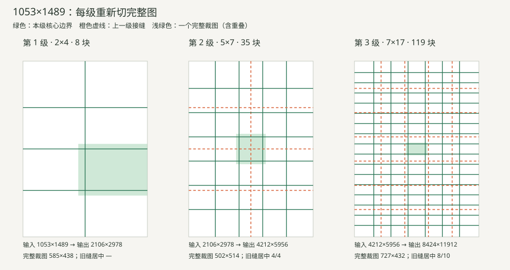

# 渐进超分：常见非整数画幅试算

> 历史算法讨论快照，保留当时尺寸限制和试算结果；现行实现已移除单图上限，见[渐进超分工作流](../STITCHING.md)。

仅计算尺寸、切图坐标与调用预算；没有调用模型、处理真实图片或修改线上服务。

## 参数与选择顺序

- 单次原生返回像素预算暂按 1,572,864（约157万）计；这是现有链路的观测值。
- 暂留宽高各10%余量，单块目标最多 1,274,019 像素，含重叠输入最多 318,504 像素。余量可通过 Policy 调整。
- 每级宽高乘2；4×、16×、64×面积对应1、2、3级。每级重新切完整的上一级结果。
- 所有完整裁图长短边比不超过2；小图不为逼近4:3增加块数。大图允许短方向超过2块。
- 候选切法优先减少调用，同预算优先让更多旧接缝进入新图块中央，再考虑接近横向4:3。
- 常规相邻重叠为完整裁图的20%；像素取整允许小偏差。根据旧缝坐标选择0、1/4、1/2、3/4步偏移，额外首尾窗口会提高边缘重叠，调用数已计入。
- 旧缝“居中”表示落入某张新裁图中央50%区域；它只衡量修复机会，不保证模型能修好。
- 基础预算＝每块1次生图＋每级1次验收；最高预算按每块最多3次尝试计算，不含新原图生成、人工局部修复和再次手动重试。
- 超出当前6400万像素或最长边32699px的组合仍列出理论切法，但不能直接交给当前服务执行。

## 12组尺寸与三档倍率

网格按 **列×行**；箭头表示每一级重新切图。括号内为总生图数＋验收数。

| 原图 | 实际宽高比 | 4× | 16× | 64× |
|---|---|---|---|---|
| 近1:1 1001×997 | 1.00401 | 2×2（4＋1） | 2×2→3×7（25＋2） | 2×2→3×7→7×11（102＋3） |
| 近4:3 1365×1024 | 1.33301 | 2×3（6＋1） | 2×3→5×5（31＋2） | 2×3→5×5→16×7（143＋3） ⚠超限 |
| 近3:4 1024×1365 | 0.75018 | 2×3（6＋1） | 2×3→5×5（31＋2） | 2×3→5×5→7×16（143＋3） ⚠超限 |
| 近3:2 1535×1023 | 1.50049 | 4×2（8＋1） | 4×2→7×5（43＋2） | 4×2→7×5→15×8（163＋3） ⚠超限 |
| 近2:3 1023×1535 | 0.66645 | 2×4（8＋1） | 2×4→5×7（43＋2） | 2×4→5×7→7×17（162＋3） ⚠超限 |
| 近16:9 1673×941 | 1.77790 | 4×2（8＋1） | 4×2→10×3（38＋2） | 4×2→10×3→12×10（158＋3） ⚠超限 |
| 近9:16 941×1673 | 0.56246 | 2×4（8＋1） | 2×4→3×10（38＋2） | 2×4→3×10→10×12（158＋3） ⚠超限 |
| 近1:√2 1053×1489 | 0.70719 | 2×4（8＋1） | 2×4→5×7（43＋2） | 2×4→5×7→7×17（162＋3） ⚠超限 |
| 近16:10 1587×992 | 1.59980 | 4×2（8＋1） | 4×2→10×3（38＋2） | 4×2→10×3→12×10（158＋3） ⚠超限 |
| 近5:4 1403×1122 | 1.25045 | 4×2（8＋1） | 4×2→5×7（43＋2） | 4×2→5×7→11×11（164＋3） ⚠超限 |
| 近9:20 843×1873 | 0.45008 | 2×4（8＋1） | 2×4→3×10（38＋2） | 2×4→3×10→10×12（158＋3） ⚠超限 |
| 近21:9 1917×821 | 2.33496 | 4×2（8＋1） | 4×2→10×3（38＋2） | 4×2→10×3→12×10（158＋3） ⚠超限 |

## 每级尺寸与预算

完整裁图列已经包含重叠。超限行是数学试算。极小裁图虽满足几何约束，实际配准纹理及生图质量仍未验证。

| 原图 | 级/累计面积 | 本级输入 | 网格 | 完整裁图→单块目标 | 本级完整结果 | 本级生图＋验收 | 累计生图＋验收 | 最多累计调用 | 旧缝居中 | 当前限额 |
|---|---|---|---|---|---|---|---|---|---|---|
| 1001×997 | 1/4× | 1001×997 | 2×2 | 557×554→1114×1108 | 2002×1994 | 4＋1 | 4＋1 | 13 | — | 通过 |
| 1001×997 | 2/16× | 2002×1994 | 3×7 | 770×399→1540×798 | 4004×3988 | 21＋1 | 25＋2 | 77 | 2/2 | 通过 |
| 1001×997 | 3/64× | 4004×3988 | 7×11 | 691×444→1382×888 | 8008×7976 | 77＋1 | 102＋3 | 309 | 8/8 | 通过 |
| 1365×1024 | 1/4× | 1365×1024 | 2×3 | 759×394→1518×788 | 2730×2048 | 6＋1 | 6＋1 | 19 | — | 通过 |
| 1365×1024 | 2/16× | 2730×2048 | 5×5 | 650×488→1300×976 | 5460×4096 | 25＋1 | 31＋2 | 95 | 3/3 | 通过 |
| 1365×1024 | 3/64× | 5460×4096 | 16×7 | 448×707→896×1414 | 10920×8192 | 112＋1 | 143＋3 | 432 | 8/8 | 超限 |
| 1024×1365 | 1/4× | 1024×1365 | 2×3 | 569×525→1138×1050 | 2048×2730 | 6＋1 | 6＋1 | 19 | — | 通过 |
| 1024×1365 | 2/16× | 2048×2730 | 5×5 | 488×650→976×1300 | 4096×5460 | 25＋1 | 31＋2 | 95 | 3/3 | 通过 |
| 1024×1365 | 3/64× | 4096×5460 | 7×16 | 707×448→1414×896 | 8192×10920 | 112＋1 | 143＋3 | 432 | 8/8 | 超限 |
| 1535×1023 | 1/4× | 1535×1023 | 4×2 | 452×569→904×1138 | 3070×2046 | 8＋1 | 8＋1 | 25 | — | 通过 |
| 1535×1023 | 2/16× | 3070×2046 | 7×5 | 614×488→1228×976 | 6140×4092 | 35＋1 | 43＋2 | 131 | 4/4 | 通过 |
| 1535×1023 | 3/64× | 6140×4092 | 15×8 | 504×620→1008×1240 | 12280×8184 | 120＋1 | 163＋3 | 492 | 9/10 | 超限 |
| 1023×1535 | 1/4× | 1023×1535 | 2×4 | 569×452→1138×904 | 2046×3070 | 8＋1 | 8＋1 | 25 | — | 通过 |
| 1023×1535 | 2/16× | 2046×3070 | 5×7 | 488×530→976×1060 | 4092×6140 | 35＋1 | 43＋2 | 131 | 4/4 | 通过 |
| 1023×1535 | 3/64× | 4092×6140 | 7×17 | 706×445→1412×890 | 8184×12280 | 119＋1 | 162＋3 | 489 | 8/10 | 超限 |
| 1673×941 | 1/4× | 1673×941 | 4×2 | 493×523→986×1046 | 3346×1882 | 8＋1 | 8＋1 | 25 | — | 通过 |
| 1673×941 | 2/16× | 3346×1882 | 10×3 | 409×724→818×1448 | 6692×3764 | 30＋1 | 38＋2 | 116 | 3/4 | 通过 |
| 1673×941 | 3/64× | 6692×3764 | 12×10 | 683×460→1366×920 | 13384×7528 | 120＋1 | 158＋3 | 477 | 10/11 | 超限 |
| 941×1673 | 1/4× | 941×1673 | 2×4 | 523×493→1046×986 | 1882×3346 | 8＋1 | 8＋1 | 25 | — | 通过 |
| 941×1673 | 2/16× | 1882×3346 | 3×10 | 724×409→1448×818 | 3764×6692 | 30＋1 | 38＋2 | 116 | 3/4 | 通过 |
| 941×1673 | 3/64× | 3764×6692 | 10×12 | 460×683→920×1366 | 7528×13384 | 120＋1 | 158＋3 | 477 | 10/11 | 超限 |
| 1053×1489 | 1/4× | 1053×1489 | 2×4 | 585×438→1170×876 | 2106×2978 | 8＋1 | 8＋1 | 25 | — | 通过 |
| 1053×1489 | 2/16× | 2106×2978 | 5×7 | 502×514→1004×1028 | 4212×5956 | 35＋1 | 43＋2 | 131 | 4/4 | 通过 |
| 1053×1489 | 3/64× | 4212×5956 | 7×17 | 727×432→1454×864 | 8424×11912 | 119＋1 | 162＋3 | 489 | 8/10 | 超限 |
| 1587×992 | 1/4× | 1587×992 | 4×2 | 467×552→934×1104 | 3174×1984 | 8＋1 | 8＋1 | 25 | — | 通过 |
| 1587×992 | 2/16× | 3174×1984 | 10×3 | 388×764→776×1528 | 6348×3968 | 30＋1 | 38＋2 | 116 | 3/4 | 通过 |
| 1587×992 | 3/64× | 6348×3968 | 12×10 | 648×484→1296×968 | 12696×7936 | 120＋1 | 158＋3 | 477 | 10/11 | 超限 |
| 1403×1122 | 1/4× | 1403×1122 | 4×2 | 413×624→826×1248 | 2806×2244 | 8＋1 | 8＋1 | 25 | — | 通过 |
| 1403×1122 | 2/16× | 2806×2244 | 5×7 | 669×449→1338×898 | 5612×4488 | 35＋1 | 43＋2 | 131 | 4/4 | 通过 |
| 1403×1122 | 3/64× | 5612×4488 | 11×11 | 624×499→1248×998 | 11224×8976 | 121＋1 | 164＋3 | 495 | 10/10 | 超限 |
| 843×1873 | 1/4× | 843×1873 | 2×4 | 469×551→938×1102 | 1686×3746 | 8＋1 | 8＋1 | 25 | — | 通过 |
| 843×1873 | 2/16× | 1686×3746 | 3×10 | 649×457→1298×914 | 3372×7492 | 30＋1 | 38＋2 | 116 | 3/4 | 通过 |
| 843×1873 | 3/64× | 3372×7492 | 10×12 | 412×765→824×1530 | 6744×14984 | 120＋1 | 158＋3 | 477 | 10/11 | 超限 |
| 1917×821 | 1/4× | 1917×821 | 4×2 | 564×457→1128×914 | 3834×1642 | 8＋1 | 8＋1 | 25 | — | 通过 |
| 1917×821 | 2/16× | 3834×1642 | 10×3 | 468×632→936×1264 | 7668×3284 | 30＋1 | 38＋2 | 116 | 3/4 | 通过 |
| 1917×821 | 3/64× | 7668×3284 | 12×10 | 783×401→1566×802 | 15336×6568 | 120＋1 | 158＋3 | 477 | 10/11 | 超限 |

## 观察

- 样本覆盖近方形、相机横竖画幅、宽屏、纸张、长屏和带状宽屏，使用奇数或不整除的实际尺寸检查取整。
- 全部采用与极端尺寸组相同的20%重叠和10%边长余量，没有针对样本修改算法。
- 横竖转置的调用数可能不同：同预算下仍偏好横向4:3，后续级还会按旧接缝坐标选择网格。
- 大图每级会重新增加图块，而不是把第一轮小块各自持续放大。
- 旧接缝不一定全部进入新块中央，不能把“重新切图”当作已经修复接缝。逐级坐标评分比机械半步偏移更可靠，但仍需要真实图片验证。

## 重新切图示意

下图只画几何网格，没有执行生图；64×那一级超过当前画布限额，仅用于观察。



## 复现

```powershell
python scripts/preview_stitch_plan.py --suite common
python stitch_planner.py 1056 1490 16
python -m unittest discover -s tests -p test_stitch_planner.py -v
```

[完整坐标与预算 JSON](plans.json) · [每级切法 CSV](cases.csv)
