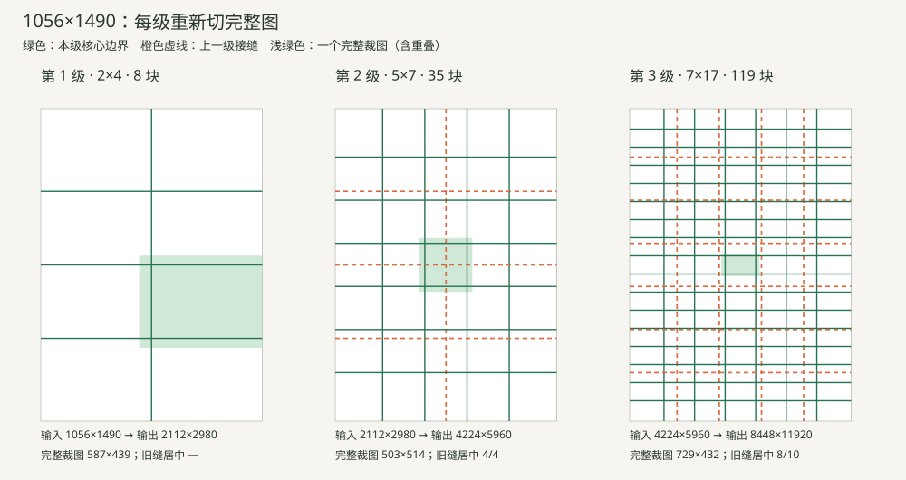

# 渐进超分：独立算法原型试算

> 历史算法讨论快照，保留当时尺寸限制和试算结果；现行实现已移除单图上限，见[渐进超分工作流](../STITCHING.md)。

仅计算尺寸、切图坐标与调用预算；没有调用模型、处理真实图片或修改线上服务。

## 参数与选择顺序

- 单次原生返回像素预算暂按 1,572,864（约157万）计；这是现有链路的观测值。
- 暂留宽高各10%余量，单块目标最多 1,274,019 像素，含重叠输入最多 318,504 像素。余量可通过 Policy 调整。
- 每级宽高乘2；4×、16×、64×面积对应1、2、3级。每级重新切完整的上一级结果。
- 所有完整裁图长短边比不超过2；小图不为逼近4:3增加块数。大图允许短方向超过2块。
- 候选切法优先减少调用，同预算优先让更多旧接缝进入新图块中央，再考虑接近横向4:3。
- 常规相邻重叠为完整裁图的20%；像素取整允许小偏差。根据旧缝坐标选择0、1/4、1/2、3/4步偏移，额外首尾窗口会提高边缘重叠，调用数已计入。
- 旧缝“居中”表示落入某张新裁图中央50%区域；它只衡量修复机会，不保证模型能修好。
- 基础预算＝每块1次生图＋每级1次验收；最高预算按每块最多3次尝试计算，不含新原图生成、人工局部修复和再次手动重试。
- 超出当前6400万像素或最长边32699px的组合仍列出理论切法，但不能直接交给当前服务执行。

## 十组尺寸与三档倍率

网格按 **列×行**；箭头表示每一级重新切图。括号内为总生图数＋验收数。

| 原图 | 4× | 16× | 64× |
|---|---|---|---|
| 极小方图 32×32 | 1×1（1＋1） | 1×1→1×1（2＋2） | 1×1→1×1→1×1（3＋3） |
| 极小横图 64×16 | 3×1（3＋1） | 3×1→4×1（7＋2） | 3×1→4×1→3×1（10＋3） |
| 极小竖图 16×64 | 1×3（3＋1） | 1×3→1×4（7＋2） | 1×3→1×4→1×3（10＋3） |
| 极瘦横图 8192×64 | 80×1（80＋1） | 80×1→81×1（161＋2） ⚠超限 | 80×1→81×1→80×1（241＋3） ⚠超限 |
| 极瘦竖图 64×8192 | 1×80（80＋1） | 1×80→1×81（161＋2） ⚠超限 | 1×80→1×81→1×80（241＋3） ⚠超限 |
| 粉色原图 1056×1490 | 2×4（8＋1） | 2×4→5×7（43＋2） | 2×4→5×7→7×17（162＋3） ⚠超限 |
| 蓝色原图 941×1672 | 2×4（8＋1） | 2×4→3×10（38＋2） | 2×4→3×10→10×12（158＋3） ⚠超限 |
| 6400万边界 1000×1000 | 2×2（4＋1） | 2×2→3×7（25＋2） | 2×2→3×7→7×11（102＋3） |
| 大正方形 4096×4096 | 8×10（80＋1） ⚠超限 | 8×10→18×18（404＋2） ⚠超限 | 8×10→18×18→31×42（1706＋3） ⚠超限 |
| 大横图 8192×2048 | 13×6（78＋1） ⚠超限 | 13×6→40×8（398＋2） ⚠超限 | 13×6→40×8→52×25（1698＋3） ⚠超限 |

## 每级尺寸与预算

完整裁图列已经包含重叠。超限行是数学试算。极小裁图虽满足几何约束，实际配准纹理及生图质量仍未验证。

| 原图 | 级/累计面积 | 本级输入 | 网格 | 完整裁图→单块目标 | 本级完整结果 | 本级生图＋验收 | 累计生图＋验收 | 最多累计调用 | 旧缝居中 | 当前限额 |
|---|---|---|---|---|---|---|---|---|---|---|
| 32×32 | 1/4× | 32×32 | 1×1 | 32×32→64×64 | 64×64 | 1＋1 | 1＋1 | 4 | — | 通过 |
| 32×32 | 2/16× | 64×64 | 1×1 | 64×64→128×128 | 128×128 | 1＋1 | 2＋2 | 8 | — | 通过 |
| 32×32 | 3/64× | 128×128 | 1×1 | 128×128→256×256 | 256×256 | 1＋1 | 3＋3 | 12 | — | 通过 |
| 64×16 | 1/4× | 64×16 | 3×1 | 25×16→50×32 | 128×32 | 3＋1 | 3＋1 | 10 | — | 通过 |
| 64×16 | 2/16× | 128×32 | 4×1 | 38×32→76×64 | 256×64 | 4＋1 | 7＋2 | 23 | 2/2 | 通过 |
| 64×16 | 3/64× | 256×64 | 3×1 | 99×64→198×128 | 512×128 | 3＋1 | 10＋3 | 33 | 3/3 | 通过 |
| 16×64 | 1/4× | 16×64 | 1×3 | 16×25→32×50 | 32×128 | 3＋1 | 3＋1 | 10 | — | 通过 |
| 16×64 | 2/16× | 32×128 | 1×4 | 32×38→64×76 | 64×256 | 4＋1 | 7＋2 | 23 | 2/2 | 通过 |
| 16×64 | 3/64× | 64×256 | 1×3 | 64×99→128×198 | 128×512 | 3＋1 | 10＋3 | 33 | 3/3 | 通过 |
| 8192×64 | 1/4× | 8192×64 | 80×1 | 128×64→256×128 | 16384×128 | 80＋1 | 80＋1 | 241 | — | 通过 |
| 8192×64 | 2/16× | 16384×128 | 81×1 | 256×128→512×256 | 32768×256 | 81＋1 | 161＋2 | 485 | 79/79 | 超限 |
| 8192×64 | 3/64× | 32768×256 | 80×1 | 511×256→1022×512 | 65536×512 | 80＋1 | 241＋3 | 726 | 80/80 | 超限 |
| 64×8192 | 1/4× | 64×8192 | 1×80 | 64×128→128×256 | 128×16384 | 80＋1 | 80＋1 | 241 | — | 通过 |
| 64×8192 | 2/16× | 128×16384 | 1×81 | 128×256→256×512 | 256×32768 | 81＋1 | 161＋2 | 485 | 79/79 | 超限 |
| 64×8192 | 3/64× | 256×32768 | 1×80 | 256×511→512×1022 | 512×65536 | 80＋1 | 241＋3 | 726 | 80/80 | 超限 |
| 1056×1490 | 1/4× | 1056×1490 | 2×4 | 587×439→1174×878 | 2112×2980 | 8＋1 | 8＋1 | 25 | — | 通过 |
| 1056×1490 | 2/16× | 2112×2980 | 5×7 | 503×514→1006×1028 | 4224×5960 | 35＋1 | 43＋2 | 131 | 4/4 | 通过 |
| 1056×1490 | 3/64× | 4224×5960 | 7×17 | 729×432→1458×864 | 8448×11920 | 119＋1 | 162＋3 | 489 | 8/10 | 超限 |
| 941×1672 | 1/4× | 941×1672 | 2×4 | 523×492→1046×984 | 1882×3344 | 8＋1 | 8＋1 | 25 | — | 通过 |
| 941×1672 | 2/16× | 1882×3344 | 3×10 | 724×408→1448×816 | 3764×6688 | 30＋1 | 38＋2 | 116 | 3/4 | 通过 |
| 941×1672 | 3/64× | 3764×6688 | 10×12 | 460×683→920×1366 | 7528×13376 | 120＋1 | 158＋3 | 477 | 10/11 | 超限 |
| 1000×1000 | 1/4× | 1000×1000 | 2×2 | 556×556→1112×1112 | 2000×2000 | 4＋1 | 4＋1 | 13 | — | 通过 |
| 1000×1000 | 2/16× | 2000×2000 | 3×7 | 770×400→1540×800 | 4000×4000 | 21＋1 | 25＋2 | 77 | 2/2 | 通过 |
| 1000×1000 | 3/64× | 4000×4000 | 7×11 | 690×445→1380×890 | 8000×8000 | 77＋1 | 102＋3 | 309 | 8/8 | 通过 |
| 4096×4096 | 1/4× | 4096×4096 | 8×10 | 621×500→1242×1000 | 8192×8192 | 80＋1 | 80＋1 | 241 | — | 超限 |
| 4096×4096 | 2/16× | 8192×8192 | 18×18 | 562×562→1124×1124 | 16384×16384 | 324＋1 | 404＋2 | 1214 | 12/16 | 超限 |
| 4096×4096 | 3/64× | 16384×16384 | 31×42 | 656×485→1312×970 | 32768×32768 | 1302＋1 | 1706＋3 | 5121 | 25/34 | 超限 |
| 8192×2048 | 1/4× | 8192×2048 | 13×6 | 773×410→1546×820 | 16384×4096 | 78＋1 | 78＋1 | 235 | — | 超限 |
| 8192×2048 | 2/16× | 16384×4096 | 40×8 | 509×621→1018×1242 | 32768×8192 | 320＋1 | 398＋2 | 1196 | 16/17 | 超限 |
| 8192×2048 | 3/64× | 32768×8192 | 52×25 | 784×406→1568×812 | 65536×16384 | 1300＋1 | 1698＋3 | 5097 | 33/46 | 超限 |

## 观察

- 32×32方图三个阶段都整图处理，没有为了4:3把极小图拆碎。
- 8192×64及其转置受2:1比例约束，第一阶段需要80块，但单块只用约2%的原生像素预算；几何可行，调用效率很差。
- 大图每级会重新增加图块，而不是把第一轮小块各自持续放大。
- 旧接缝不一定全部进入新块中央，不能把“重新切图”当作已经修复接缝。逐级坐标评分比机械半步偏移更可靠，但仍需要真实图片验证。

## 重新切图示意

下图只画几何网格，没有执行生图；64×那一级超过当前画布限额，仅用于观察。



## 复现

```powershell
python scripts/preview_stitch_plan.py
python stitch_planner.py 1056 1490 16
python -m unittest discover -s tests -p test_stitch_planner.py -v
```

[完整坐标与预算 JSON](plans.json) · [每级切法 CSV](cases.csv)
